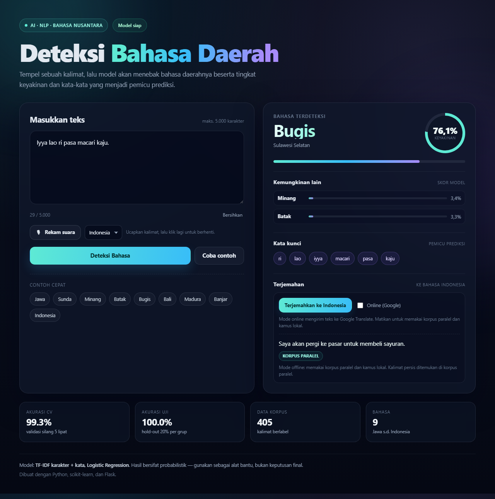

# Detektor Bahasa Daerah Indonesia

Aplikasi AI untuk mendeteksi **bahasa daerah Indonesia** dari sebuah teks, lalu **menerjemahkannya ke bahasa Indonesia**. Tersedia juga **input suara (mic)** di web. Dibuat dengan **Python**, **scikit-learn**, dan **Flask**.

Model dapat membedakan 9 kelas:

| Bahasa | Wilayah |
|---|---|
| Jawa | Jawa Tengah, Yogyakarta, Jawa Timur |
| Sunda | Jawa Barat, Banten |
| Minang | Sumatera Barat |
| Batak | Sumatera Utara (Batak Toba) |
| Bugis | Sulawesi Selatan |
| Bali | Bali |
| Madura | Jawa Timur (Pulau Madura) |
| Banjar | Kalimantan Selatan |
| Indonesia | Bahasa Indonesia (bahasa nasional) |

Contoh:

```text
Teks       : Aku arep menyang pasar tuku sayur.
Bahasa     : Jawa
Keyakinan  : 76.9%
Kata kunci : aku, menyang, tuku, arep, sayur, pasar
```



## Fitur

- **Deteksi 9 bahasa** sekaligus (8 bahasa daerah + Indonesia).
- **TF-IDF karakter (2–5 gram) + kata (1–2 gram)** untuk menangkap ciri kata sekaligus pola ejaan/imbuhan.
- **Logistic Regression** dengan pemilihan parameter `C` memakai validasi silang.
- **Group-aware split**: kalimat paralel tidak bocor antara data latih dan data uji.
- **Kata kunci pemicu** prediksi ditampilkan untuk membantu interpretasi.
- **Terjemahan hybrid ke bahasa Indonesia**: Google Translate untuk bahasa yang didukung, lalu korpus paralel dan kamus lokal sebagai cadangan.
- **Mode offline** untuk terjemahan tanpa mengirim teks ke layanan online.
- **Input suara (mic)** memakai Web Speech API di browser.
- **Web UI** modern dan responsif, plus **REST API** JSON.
- **CLI** untuk prediksi satu kalimat, file, atau mode interaktif, dengan opsi terjemahan.
- **Laporan evaluasi** otomatis (akurasi, precision/recall/F1, confusion matrix).

## Struktur proyek

```text
deteksibahasa/
├── app.py                     # Web app Flask
├── train.py                   # Skrip pelatihan
├── predict.py                 # CLI prediksi
├── requirements.txt
├── data/
│   ├── korpus.csv             # 405 kalimat berlabel, 9 bahasa, 45 grup paralel
│   └── kamus/                 # Kamus kata/frasa per bahasa (JSON)
├── bahasa_detector/
│   ├── config.py              # Path, konstanta, info wilayah, konfigurasi terjemahan
│   ├── teks.py                # Normalisasi teks
│   ├── dataset.py             # Pembacaan & validasi korpus
│   ├── model.py               # Pipeline + wrapper DetektorBahasa
│   ├── terjemah.py            # Terjemahan hybrid ke bahasa Indonesia
│   └── latih.py               # Pelatihan, evaluasi, penyimpanan
├── templates/index.html
├── static/style.css
├── static/app.js
├── tests/test_detektor.py
├── models/                    # model_bahasa.joblib (dibuat saat training)
└── reports/                   # laporan_evaluasi.txt, metrics.json
```

## Instalasi

Prasyarat: **Python 3.10+** (proyek ini diuji dengan Python 3.14).

```powershell
# opsional: buat virtual environment
python -m venv .venv
.\.venv\Scripts\Activate.ps1

pip install -r requirements.txt
```

## 1. Latih model

```powershell
python train.py
```

Perintah ini akan:

1. membaca `data/korpus.csv`;
2. memilih parameter `C` dengan validasi silang berkelompok;
3. mengevaluasi model pada data hold-out;
4. melatih ulang model pada seluruh data;
5. menyimpan `models/model_bahasa.joblib`;
6. menulis `reports/laporan_evaluasi.txt` dan `reports/metrics.json`.

Opsi lain:

```powershell
python train.py --data data/korpus.csv --model models/model_bahasa.joblib
python train.py --test-size 0.25 --seed 123 --C 1 3 8 15
```

## 2. Prediksi lewat CLI

```powershell
python predict.py "Aku arep menyang pasar tuku sayur kanggo masak sesuk."
python predict.py "Ulun handak tulak ka pasar mambali sayur."
python predict.py --json "Titiang jagi lunga ka pasar meli jukut."
python predict.py --file teks.txt
python predict.py --interaktif

# Dengan terjemahan ke bahasa Indonesia
python predict.py --terjemahkan "Sengko' arep mangkat ka pasar nyare sayur."
python predict.py --terjemahkan --offline "Iyya lao ri pasa macari kaju."
python predict.py --terjemahkan --json "Ulun handak tulak ka pasar mambali sayur."
```

Contoh output:

```text
------------------------------------------------------------
Teks       : Ulun handak tulak ka pasar mambali sayur.
Bahasa     : Banjar
Wilayah    : Kalimantan Selatan
Keyakinan  : 85.4%
Kata kunci : ulun, handak, tulak, mambali, ka, sayur
Terjemahan : Saya akan pergi ke pasar untuk membeli sayuran.
Metode     : korpus
Info       : Mode offline: memakai korpus paralel dan kamus lokal. Kalimat persis ditemukan di korpus paralel.
------------------------------------------------------------
```

Opsi `--offline` memaksa terjemahan memakai korpus dan kamus lokal tanpa
menghubungi Google Translate. Opsi ini hanya berlaku bersama `--terjemahkan`.

## 3. Jalankan web app

```powershell
python app.py
```

Buka <http://127.0.0.1:5000>. Di halaman ini kamu bisa:

- mengetik/menempel teks;
- memilih contoh cepat untuk setiap bahasa;
- melihat bahasa terdeteksi, tingkat keyakinan, 3 kandidat teratas, dan kata kunci;
- menekan **Terjemahkan ke Indonesia** untuk menerjemahkan hasil deteksi;
- mematikan centang **Online (Google)** agar terjemahan berjalan offline;
- menekan **Rekam suara** dan berbicara untuk mengisi teks otomatis (mic).

Tautan berbagi juga bisa langsung membuka hasil deteksi dan terjemahan:

```text
http://127.0.0.1:5000/?teks=Ulun%20handak%20tulak%20ka%20pasar&terjemahkan=1&online=0
```

Parameter `online=0` mematikan terjemahan online.

### Terjemahan

| Bahasa | Online (Google) | Cadangan offline |
|---|---|---|
| Jawa, Sunda, Minang, Batak, Bali, Madura | Ya | Korpus paralel + kamus |
| Bugis, Banjar | Tidak didukung Google | Korpus paralel + kamus |
| Indonesia | — | Teks dikembalikan apa adanya |

Urutan strategi terjemahan:

```text
Teks bahasa daerah
        │
        ▼
Online aktif dan bahasa didukung? ── ya ──► Google Translate
        │ tidak/gagal
        ▼
Cari kalimat paling mirip di korpus paralel (TF-IDF karakter + cosine)
        │ cocok (≥ ambang)
        ▼
Terjemahan kata/frasa dari kamus lokal
        │ cakupan cukup
        ▼
Kembalikan teks asli + catatan "belum tersedia"
```

Setiap hasil menyertakan `metode` (`online`, `korpus`, `kamus`, `sama`, atau
`tidak-tersedia`) dan `catatan` agar kualitas terjemahan transparan.

> **Privasi:** mode online mengirim teks ke Google Translate. Matikan centang
> **Online (Google)** atau gunakan `--offline` jika teks bersifat sensitif.

### Mic

Mic memakai **Web Speech API** bawaan browser, jadi tidak perlu memasang
Whisper atau dependensi server tambahan.

- Gunakan **Chrome** atau **Edge** terbaru.
- Harus dijalankan di `localhost` atau HTTPS.
- Pilih bahasa ucapan di samping tombol mic. Dukungan bahasa bergantung pada
  browser; bahasa Indonesia dan Jawa umumnya tersedia, bahasa lain bisa
  terbatas.
- Audio diproses oleh layanan pengenalan suara browser (biasanya Google atau
  Microsoft), bukan oleh server aplikasi ini.

Opsi:

```powershell
python app.py --host 0.0.0.0 --port 8000
python app.py --debug
```

## 4. Gunakan sebagai library Python

```python
from bahasa_detector import DetektorBahasa, Penerjemah

detektor = DetektorBahasa.dari_file("models/model_bahasa.joblib")
penerjemah = Penerjemah(online=False)  # offline: tanpa Google Translate

teks = "Sengko' arep mangkat ka pasar nyare sayur."
hasil = detektor.prediksi(teks)

print(hasil["bahasa"])        # Madura
print(hasil["keyakinan"])     # 0.9...
print(hasil["top"])           # 3 kandidat + skor
print(hasil["kata_kunci"])    # kata pemicu prediksi

terjemahan = penerjemah.terjemahkan(
    teks, bahasa=hasil["bahasa"], online=False
)
print(terjemahan["terjemahan"])  # teks bahasa Indonesia
print(terjemahan["metode"])      # online / korpus / kamus / sama
```

Jika `bahasa` tidak diberikan, `Penerjemah` akan memuat model deteksi dan
menebak bahasanya secara otomatis.

## 5. REST API

### `POST /api/deteksi`

Request:

```json
{
  "teks": "Abdi badé angkat ka pasar kanggo meuli sayuran."
}
```

Response:

```json
{
  "teks": "Abdi badé angkat ka pasar kanggo meuli sayuran.",
  "teks_bersih": "abdi badé angkat ka pasar kanggo meuli sayuran",
  "bahasa": "Sunda",
  "keyakinan": 0.756,
  "wilayah": "Jawa Barat, Banten",
  "top": [
    {"bahasa": "Sunda", "keyakinan": 0.756, "wilayah": "Jawa Barat, Banten"},
    {"bahasa": "Madura", "keyakinan": 0.037, "wilayah": "Jawa Timur (Pulau Madura)"},
    {"bahasa": "Indonesia", "keyakinan": 0.035, "wilayah": "Bahasa Indonesia (bahasa nasional)"}
  ],
  "kata_kunci": ["abdi", "badé", "angkat", "ka", "meuli", "sayuran"],
  "peringatan": null
}
```

Contoh PowerShell:

```powershell
$body = @{ teks = "Abdi badé angkat ka pasar." } | ConvertTo-Json
Invoke-RestMethod -Uri http://127.0.0.1:5000/api/deteksi `
  -Method Post -ContentType "application/json" -Body $body
```

### `POST /api/terjemahkan`

Request:

```json
{
  "teks": "Iyya lao ri pasa macari kaju.",
  "bahasa": "Bugis",
  "online": false
}
```

- `teks` — wajib, maksimal 5.000 karakter.
- `bahasa` — opsional. Jika kosong, bahasa dideteksi otomatis.
- `online` — opsional. `true` memakai Google Translate bila didukung;
  `false` memaksa mode offline. Default mengikuti `TERJEMAHAN_ONLINE` di
  `bahasa_detector/config.py`.

Response:

```json
{
  "teks": "Iyya lao ri pasa macari kaju.",
  "bahasa": "Bugis",
  "terjemahan": "Saya akan pergi ke pasar untuk membeli sayuran.",
  "metode": "korpus",
  "kecocokan": 1.0,
  "catatan": "Mode offline: memakai korpus paralel dan kamus lokal. Kalimat persis ditemukan di korpus paralel.",
  "online": false,
  "kode_bahasa": null
}
```

Nilai `metode`:

| Metode | Arti |
|---|---|
| `online` | Diterjemahkan Google Translate |
| `korpus` | Ditemukan kalimat padanan di korpus paralel |
| `kamus` | Terjemahan kata/frasa dari kamus lokal |
| `sama` | Teks sudah berbahasa Indonesia |
| `tidak-tersedia` | Belum bisa diterjemahkan; teks asli dikembalikan |

Contoh PowerShell:

```powershell
$body = @{
  teks = "Ulun handak tulak ka pasar mambali sayur."
  online = $false
} | ConvertTo-Json
Invoke-RestMethod -Uri http://127.0.0.1:5000/api/terjemahkan `
  -Method Post -ContentType "application/json" -Body $body
```

Endpoint lain:

- `GET /api/info` — metadata model (akurasi, jumlah data, waktu training).
- `GET /api/sehat` — health check.

## Hasil evaluasi

Dengan korpus bawaan (405 kalimat, 9 kelas, 45 grup paralel):

| Metrik | Nilai |
|---|---|
| Akurasi hold-out (20%, dipisah per grup) | **100,0%** |
| Macro F1 hold-out | **1,000** |
| Akurasi validasi silang 5 lipat | **99,3%** |
| Macro F1 validasi silang | **0,993** |

Detail per kelas dan confusion matrix ada di `reports/laporan_evaluasi.txt`.

> **Penting:** korpus bawaan adalah data awal yang disusun untuk demonstrasi. Kalimatnya relatif mirip antarbahasa (terjemahan paralel), sehingga skor di atas **belum mewakili** performa di dunia nyata. Untuk penggunaan serius, ganti dengan korpus yang lebih besar, beragam, dan berasal dari penutur asli.

## Cara kerja model

```text
Teks mentah
   │
   ▼
Normalisasi (lowercase, hapus URL/tanda baca, rapikan spasi)
   │
   ▼
┌───────────────────────────────┐
│ TF-IDF char_wb 2–5 gram       │  ← pola ejaan & imbuhan
│ TF-IDF kata 1–2 gram          │  ← kosakata & frasa khas
└───────────────────────────────┘
   │
   ▼
Logistic Regression (multinomial, class_weight=balanced)
   │
   ▼
Probabilitas per bahasa → top-3 + kata kunci
```

Kata kunci diperoleh dari kontribusi fitur kata terhadap koefisien kelas terpilih.

## Menambah bahasa atau data

Edit `data/korpus.csv` dengan format:

```csv
grup,bahasa,teks
46,Aceh,"Lon jak u blang."
46,Jawa,"Aku arep menyang sawah."
```

- `bahasa` — nama kelas (bebas).
- `teks` — kalimat dalam bahasa tersebut.
- `grup` — opsional; kalimat dengan grup sama dianggap paralel dan tidak akan dipisah antara train/test. Jika tidak ada, setiap baris dianggap grup sendiri.

Setiap bahasa minimal punya **5 contoh**, tetapi disarankan **≥ 100 kalimat beragam** per bahasa. Setelah menambah data, jalankan `python train.py` lagi.

Untuk menambah wilayah tampilan, edit `WILAYAH` di `bahasa_detector/config.py`.

## Pengujian

```powershell
python -m unittest discover -s tests -v
```

Test mencakup normalisasi teks, validasi korpus, prediksi kalimat baru,
terjemahan offline (korpus, kamus, aksen/apostrof), endpoint deteksi dan
terjemahan, serta keberadaan kontrol mic/terjemahan di halaman web. Test
model/API otomatis dilewati jika model belum dilatih. Total saat ini **29
test**.

## Keterbatasan

- Korpus masih kecil dan bersifat demonstrasi; akurasi dunia nyata akan lebih rendah.
- Bahasa dengan banyak dialek (mis. Batak, Bugis, Banjar) disederhanakan menjadi satu kelas.
- Teks sangat pendek (1–2 kata) atau campur kode sulit dideteksi.
- Model probabilistik; selalu tampilkan keyakinan dan gunakan sebagai alat bantu.
- Belum menangani bahasa daerah lain seperti Aceh, Nias, Dayak, Toraja, dan Papua.
- Terjemahan online memakai endpoint publik Google Translate yang tidak resmi;
  kualitas, ketersediaan, dan kuotanya bisa berubah sewaktu-waktu.
- Terjemahan offline hanya sebaik korpus paralel (45 kalimat) dan kamus bawaan.
  Kalimat di luar cakupan akan memakai terjemahan kata per kata atau
  dikembalikan apa adanya dengan catatan.
- Bugis dan Banjar belum didukung Google Translate, sehingga kualitas
  terjemahannya lebih rendah daripada bahasa lain.
- Mic membutuhkan browser modern, koneksi internet, dan izin mikrofon. Hasil
  ucapan bisa salah, terutama untuk dialek atau aksen yang kuat.

## Pengembangan lanjutan

- Ganti TF-IDF dengan **fastText** atau **IndoBERT** untuk konteks yang lebih kaya.
- Tambahkan **deteksi campur kode** dan bahasa tidak dikenal (out-of-distribution).
- Kumpulkan korpus dari Wikipedia bahasa daerah, cerita rakyat, atau media sosial.
- Tambahkan **kalibrasi probabilitas** (Platt/isotonic) dan threshold per bahasa.
- Deploy dengan Docker + Gunicorn, atau jadikan PWA.

---

Dibuat dengan Python, scikit-learn, dan Flask.
